# 👋 안녕하세요, 최준혁입니다  
AI · Machine Learning · Deep Learning을 중심으로 공부하며 코드를 정리하는 개발자입니다.

---

## 🧰 Tech Stack

---

## 📁 대표 학습 레포지토리

- **python/** – 파이썬 기초 문법 연습  
- **python_import/** – 모듈·패키지 import 연습  
- **ml/** – 머신러닝 알고리즘 학습  
- **keras/**, **keras2/** – Keras 기반 딥러닝  
- **torch/** – PyTorch 기반 모델 구현  
- **AE/** – AutoEncoder 및 표현학습  

---

# 🐍 Contribution Graph (Snake Animation)

_아래는 자동 생성되는 기여 그래프 애니메이션입니다._

---

## 📫 Contact  
GitHub: https://github.com/junhyeokk97  

<b>꾸준함은 실력을 만든다.</b>

